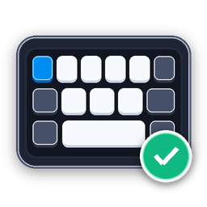

<p align="center">
  
  <h1 align="center">KeyboardChatteringFix</h1>
  <strong>Modern, Ultra-Lightweight Keyboard Chatter Filter with Fluent UI & Ed25519 Auto-Update for Windows</strong><br>
  Windows 11 모던 Fluent UI와 암호학적 자동 업데이트를 갖춘 초경량 고성능 키보드 채터링 방지 솔루션
</p>

<p align="center">
  
  
  
  
  
  
</p>

---

## Language / 언어 선택
- [English](#english)
- [한국어](#한국어)

---

<a id="english"></a>
## English

### Overview

**KeyboardChatteringFix** is an ultra-lightweight, high-performance Windows utility built with pure Rust. It intercepts and filters mechanical keyboard switch bouncing (chatter / double typing) in real time using low-level Windows hooks (`WH_KEYBOARD_LL`) without requiring administrator privileges or invasive DLL injection.

Featuring a native Windows 11 Fluent Card interface, real-time diagnostic telemetry, convenient cleaning mode, and an Ed25519 cryptographically signed auto-update pipeline, KeyboardChatteringFix keeps your typing flawless while consuming under 5MB of RAM.

---

### Key Capabilities

#### 1. Zero-Latency Filtering Engine
- **Sub-Millisecond Response**: Intercepts chattered keystrokes at the OS hook layer before applications receive them.
- **1ms High-Precision Multimedia Timer**: Engages `timeBeginPeriod(1)` to eliminate Windows default scheduler jitter (15.6ms), ensuring microsecond-level debounce accuracy.
- **Synthetic Input Protection (`LLKHF_INJECTED`)**: Recognizes artificial input generated by AutoHotkey, IMEs, screen readers, and remote desktop tools, preventing macro and typing glitches.
- **Hardware-Accurate Debounce Modes**:
  - `Release` (Default): Measures elapsed time from key release (`Up`) to the next press (`Down`). Highly robust against prolonged holds.
  - `Press`: Measures interval between consecutive accepted presses (`Down` to `Down`).
- **Auto-Repeat Preservation**: Holding a key forwards continuous down events naturally without false-positive blocks.
- **Microsecond Glitch Filter (`min_chatter_ms`)**: Filters out 0ms-class electrical glitches and buggy hardware events cleanly.

#### 2. Native Windows 11 Fluent UI
- **Immersive Dark / Light Theme Sync**: Dynamically detects the system theme (`AppsUseLightTheme`) and applies dark titlebars (`DWMWA_USE_IMMERSIVE_DARK_MODE`).
- **Rounded Corners & Dark Titlebar**: Native Windows 11 aesthetics with rounded window geometry (`DWMWA_WINDOW_CORNER_PREFERENCE = ROUND`).
- **Modern Typography**: Clear, crisp font rendering using Segoe UI Variable and Malgun Gothic.
- **Double-Buffered Rendering**: Smooth rendering with zero flickering during real-time telemetry updates.

#### 3. Real-Time Telemetry & Diagnostics
- **Live Metrics**: Real-time display of total keystrokes, chatter intercepted count, and chatter ratio (%).
- **Recent Blocked Key Badge**: Displays the exact virtual key name and observed gap in milliseconds (`Last blocked: Space (32ms)`).
- **Top Problematic Key Detection**: Tracks keystrokes per key (0–255) to automatically diagnose your most degraded switch and its failure rate.
- **100+ Virtual Key Name Map**: Human-readable names for media keys, volume controls, numpad, F1–F24, and navigation keys.

#### 4. Helpful Tools & Customization
- **🧹 Keyboard Cleaning Mode**: Locks all keyboard inputs so you can clean and wipe keycaps safely. Press `Enter` to immediately unlock.
- **🔊 Custom Audio (.wav) & Tester**: Play custom `.wav` sounds or system beeps on chatter detection, complete with an in-app test button.
- **⚙️ Windows Keyboard Control Panel**: One-click shortcut to launch Windows Keyboard Properties (`control.exe keyboard`) to calibrate repeat delays and rates.
- **Per-Key Custom Overrides**: Set global thresholds (e.g. 50ms) while assigning dedicated thresholds to specific erratic keys.
- **Window Close Customization (`bCloseToTray`)**: Choose whether the close button (X) minimizes to tray or exits completely.

#### 5. Secure Ed25519 Auto-Update Pipeline
- **Cryptographic Verification**: Auto-update manifests (`update.json`) are verified using Ed25519 digital signatures and SHA-256 binary digests.
- **Fail-Safe In-Place Replacement**: The dedicated companion helper (`kcfix-updater.exe`) safely swaps binaries in `%TEMP%` and automatically rolls back if health checks fail.

---

### Project Architecture

```
keyboard-chattering-fix/
├── Cargo.toml                  # Workspace & release manifest
├── src/
│   ├── main.rs                 # Bootstrap only (CLI → bootstrap::run)
│   ├── app/                    # Startup, CLI, single-instance guard, shared state
│   ├── input/                  # Keyboard hook (zero-alloc) & cached sound playback
│   ├── debounce.rs             # Core state machine, per-key stats & cleaning mode
│   ├── config/                 # Settings model, atomic INI storage, autostart, sound
│   ├── i18n/                   # Bilingual string tables (English / Korean)
│   ├── ui/                     # Window, snapshot-diff stats, tray, paint, settings form
│   └── updater/                # Ed25519 verification, HTTP staging & update logic
├── crates/
│   └── kcfix-updater/          # Standalone update helper for safe in-place replacement
├── tests/
│   ├── version_sync.rs         # Automated guard against version and pipeline drift
│   └── exe_smoke.rs            # Real-binary --version/-V launch smoke test
└── docs/
    └── UPDATE.md               # Detailed update pipeline & signing documentation
```

---

### Configuration Guide

Settings are saved in `%APPDATA%\KeyboardChatteringFix\settings.ini`:

```ini
[KeyboardChatteringFix]
iThreshold=50          # Global chatter threshold in ms (1–1000)
bFilterEnabled=1       # Enable (1) or disable (0) chatter filtering
bPlaySound=0           # Play notification sound on block (1=On, 0=Off)
lpSoundFile=           # Path to custom .wav file (empty = default beep)
bMinimizeOnLaunch=0    # Minimize to tray on startup (1=On, 0=Off)
bCloseToTray=1         # Minimize to tray on window close (1=On, 0=Exit)
bRecordAllKeypress=0   # Telemetry log: 1=record all keys, 0=blocked chatter only
iLogLimit=100          # Maximum in-memory log buffer size
sLanguage=en           # Interface language: "en" or "ko"
sMeasureFrom=release   # Measurement baseline: "release" or "press"
iMinChatterMs=0        # Ignore chatter intervals below this limit (ms)
bExcludeInjected=1     # Ignore synthetic events from AHK/IME/macros (1=On)

# Per-key overrides: key.<HEX_VIRTUAL_KEY>=<MILLISECONDS>
key.48=120             # Custom 120ms threshold for 'H' key (0x48)
key.20=80              # Custom 80ms threshold for Spacebar (0x20)
```

---

### Building & Testing

#### Prerequisites
- Windows 10 / 11 (64-bit)
- Rust toolchain (stable, 2021 edition)

```powershell
# Clone the repository
git clone https://github.com/twbeatles/keyboard-chattering-fix.git
cd keyboard-chattering-fix

# Run automated test suite (79 Rust tests)
cargo test --workspace

# Release-script tests (needs Python, once per machine)
pip install -r scripts/requirements.txt
python -m pytest scripts/

# Enable the pre-push gate (once per clone)
powershell -ExecutionPolicy Bypass -File .\scripts\setup_githooks.ps1

# Build optimized release binary (LTO + strip enabled)
cargo build --release
```

The compiled binary will be placed at `target/release/keyboard-chattering-fix.exe`.

---

### Checking for Updates

- Right-click the system tray icon and choose **Check for Updates**.
- From a terminal: `KeyboardChatteringFix.exe --check-update`.
- Update manifests are Ed25519-signed and applied by `kcfix-updater.exe` (shipped next to the app). Maintainer docs: [docs/UPDATE.md](docs/UPDATE.md) (Korean).

---

<a id="한국어"></a>
## 한국어

### 소개

**KeyboardChatteringFix**는 순수 Rust로 개발된 초경량 고성능 Windows 키보드 채터링(스위치 바운스 / 이중 입력) 방지 유틸리티입니다. 기계식 및 접점식 키보드의 스위치 노후화나 접점 결함으로 인해 키가 빠르게 연타되는 현상을 저수준 키보드 훅(`WH_KEYBOARD_LL`)을 통해 실시간으로 감지하고 차단합니다.

관리자 권한이나 위험한 DLL 인젝션 없이 동작하며, **Windows 11 모던 Fluent UI**, **실시간 진단 텔레메트리**, **키보드 청소 모드**, 그리고 **Ed25519 암호학적 디지털 서명 기반의 안전한 자동 업데이트 파이프라인**을 갖추고 있으면서도 5MB 미만의 극도로 낮은 메모리 점유율을 유지합니다.

---

### 핵심 기능 및 특장점

#### 1. 마이크로초 단위 초저지연 필터링 엔진
- **OS 레벨 즉각 차단**: 키 신호가 애플리케이션으로 넘어가기 전 윈도우 훅 레이어에서 바운스 신호만 가로채 안전하게 드롭합니다.
- **1ms 고정밀 멀티미디어 타이머**: `timeBeginPeriod(1)`을 적용하여 Windows 기본 스케줄러 지터(15.6ms)를 제거하고 초정밀 밀리초 측정을 보장합니다.
- **가상/합성 입력 완벽 보호 (`LLKHF_INJECTED`)**: AutoHotkey, 한영 변환(IME), 원격 데스크톱 등 소프트웨어가 생성한 매크로 신호를 자동 감지하여 건드리지 않습니다.
- **상황별 채터링 측정 모드 (`MeasureFrom`)**:
  - `Release` (기본값): 키를 뗀(`Up`) 시점부터 다음 눌린(`Down`) 시점까지의 시간을 측정하여 느린 릴리스에서도 완벽하게 보호합니다.
  - `Press`: 이전 정상 입력(`Down`) 시점부터 다음 입력 시점까지의 간격을 측정합니다.
- **오토리핏(연속 입력) 보존**: 키를 누르고 있을 때 발생하는 연속 Down 입력은 차단하지 않고 정상 전달합니다.
- **하드웨어 글리치 필터 (`min_chatter_ms`)**: 0ms 급 드라이버 오류나 기기 이상 입력을 필터링 예외로 지정할 수 있습니다.

#### 2. Windows 11 모던 Fluent UI 대시보드
- **시스템 테마 실시간 동기화**: Windows 다크/라이트 모드(`AppsUseLightTheme`)를 감지하여 다크 타이틀바(`DWMWA_USE_IMMERSIVE_DARK_MODE`)와 테마를 자동 적용합니다.
- **Windows 11 둥근 창 모서리**: `DWMWA_WINDOW_CORNER_PREFERENCE = ROUND`로 윈도우 11 특유의 미려한 둥근 창을 제공합니다.
- **Segoe UI Variable & 맑은 고딕 모던 타이포그래피**: 고해상도 클리어타입 폰트를 계층별(Bold/Semibold/Regular)로 정밀 렌더링합니다.
- **더블 버퍼링(Double Buffering)**: 실시간 수치 갱신이나 창 조작 시 화면 깜빡임(Flicker)이 전혀 없습니다.

#### 3. 실시간 텔레메트리 및 스위치 수명 진단
- **실시간 통계 그리드**: 총 타건 수, 차단된 채터링 횟수, 채터링 발생 비율(%)을 타일 카드로 시각화합니다.
- **최근 차단 키 알림 칩**: 가장 최근 차단된 키와 실제 바운스 간격(`최근 차단: Space (32ms 간격)`)을 실시간 표시합니다.
- **최다 불량 키(Top Chatter Key) 자동 진단**: 256개 가상키별 누적 타건수와 차단수를 분석하여 가장 상태가 나쁜 스위치와 불량 비율을 자동 추적합니다.
- **100+개 전체 가상키 이름 매핑**: 미디어 키, 볼륨, 넘패드, F1~F24, 방향키 등을 직관적인 이름으로 출력합니다.

#### 4. 유용한 도구 및 편의 기능
- **🧹 키보드 청소 모드 (Clean Keyboard)**: 키캡을 닦을 때 키가 잘못 입력되지 않도록 모든 키보드 입력을 일시 차단합니다. 청소 후 `Enter` 키를 누르면 즉시 잠금이 해제됩니다.
- **🔊 커스텀 알림음 (.wav) & 사운드 테스트**: 채터링 차단 시 기본 비프음 외에 사용자가 지정한 `.wav` 효과음을 재생할 수 있으며, UI에서 즉시 테스트 청취가 가능합니다.
- **⚙️ Windows 키보드 설정 바로가기**: `control.exe keyboard`를 원클릭으로 호출하여 키 반복 속도 및 지연 시간을 조율합니다.
- **키별 개별 임계값 (Per-Key Override)**: 전체 키에는 50ms 등 낮은 전역값을 두고, 말썽인 키에만 높은 임계값을 개별 할당할 수 있습니다.
- **창 닫기 동작 커스터마이징 (`bCloseToTray`)**: 창 닫기(X 버튼) 시 트레이로 최소화할지, 완전 종료할지 선택 가능합니다.

#### 5. Ed25519 서명 기반 안전한 자동 업데이트 파이프라인
- **암호학적 서명 검증**: GitHub Releases의 `update.json` 매니페스트를 Ed25519 공개키와 SHA-256 해시로 이중 검증하여 변조를 완벽히 차단합니다.
- **안전한 인플레이스 교체 및 자동 롤백**: 전용 헬퍼(`kcfix-updater.exe`)가 앱 종료를 기다려 안전하게 교체하며, 교체 실패 시 자동으로 이전 버전으로 롤백 복구합니다.

---

### 아키텍처 및 내부 구조

```
keyboard-chattering-fix/
├── Cargo.toml                  # 프로젝트 및 릴리스 프로파일 명세
├── src/
│   ├── main.rs                 # 부트스트랩 전용 (CLI → bootstrap::run)
│   ├── app/                    # 기동 순서, CLI, 단일 인스턴스 가드, 공유 상태
│   ├── input/                  # 키보드 훅(무할당) 및 캐시된 사운드 재생
│   ├── debounce.rs             # 디바운서 상태 머신, 키별 누적 통계 및 청소 모드
│   ├── config/                 # 설정 모델, 원자적 INI 저장, 자동실행, 사운드 검증
│   ├── i18n/                   # 한국어 및 영어 동적 다국어 문자열 테이블
│   ├── ui/                     # 창, 스냅샷-디프 통계, 트레이, 페인트, 설정 폼
│   └── updater/                # Ed25519 서명 검증, 다운로드 스테이징 및 버전 확인 로직
├── crates/
│   └── kcfix-updater/          # 프로세스 안전 교체 및 자동 롤백을 수행하는 독립 헬퍼 바이너리
├── tests/
│   ├── version_sync.rs         # 빌드 및 릴리스 파이프라인 버전 불일치 방지 회귀 테스트
│   └── exe_smoke.rs            # 실제 바이너리 --version/-V 실행 스모크 테스트
└── docs/
    └── UPDATE.md               # 업데이트 배포 파이프라인 및 서명 키 관리 기술 문서
```

---

### 설정 파일 상세 안내

설정 파일은 `%APPDATA%\KeyboardChatteringFix\settings.ini`에 자동으로 보존됩니다:

```ini
[KeyboardChatteringFix]
iThreshold=50          # 전역 채터링 임계값(ms). 이 시간 내의 재입력은 차단됨
bFilterEnabled=1       # 채터링 필터 활성화 (1=켜짐, 0=꺼짐)
bPlaySound=0           # 차단 시 알림음 재생 여부 (1=켜짐, 0=꺼짐)
lpSoundFile=           # 사용자 지정 .wav 사운드 파일 경로 (비우면 기본 비프음)
bMinimizeOnLaunch=0    # 실행 시 트레이로 최소화 (1=켜짐, 0=꺼짐)
bCloseToTray=1         # 창 닫기(X) 시 트레이로 최소화 (1=켜짐, 0=완전 종료)
bRecordAllKeypress=0   # 모든 키 누름 로깅 (1=모든 키, 0=차단된 채터링만)
iLogLimit=100          # 메모리 내 실시간 로그 보관 수
sLanguage=ko           # 인터페이스 언어 ("ko" 또는 "en")
sMeasureFrom=release   # 간격 측정 기준 ("release" 또는 "press")
iMinChatterMs=0        # 이 값보다 작은 간격은 결함 입력으로 간주하여 통과
bExcludeInjected=1     # 외부 매크로/IME 합성 입력 제외 (1=권장)

# 키별 개별 임계값 설정: key.<16진수_가상키코드>=<밀리초>
key.48=120             # 'H' 키(0x48)에만 120ms 적용
key.20=80              # 스페이스바(0x20)에만 80ms 적용
```

---

### 빌드 및 검증

#### 요구 사항
- Windows 10 / 11 (64비트)
- Rust 툴체인 (stable, 2021 edition)

```powershell
# 저장소 복제
git clone https://github.com/twbeatles/keyboard-chattering-fix.git
cd keyboard-chattering-fix

# 단위 및 통합 테스트 실행 (79개 Rust 테스트 검증)
cargo test --workspace

# 릴리스 스크립트 테스트 (Python 필요, 머신당 1회)
pip install -r scripts/requirements.txt
python -m pytest scripts/

# pre-push 게이트 활성화 (클론당 1회)
powershell -ExecutionPolicy Bypass -File .\scripts\setup_githooks.ps1

# 고도로 최적화된 단일 바이너리 빌드 (LTO + strip 활성화)
cargo build --release
```

컴파일된 실행 파일은 `target/release/keyboard-chattering-fix.exe`에 생성됩니다.

---

### 업데이트 확인

- 시스템 트레이 아이콘 우클릭 → **업데이트 확인** 메뉴로 새 버전을 확인할 수 있습니다.
- 터미널에서는 `KeyboardChatteringFix.exe --check-update`로 확인할 수 있습니다.
- 업데이트 파일은 Ed25519 서명으로 검증되며, 교체는 `kcfix-updater.exe`(앱과 같은 폴더)가 수행합니다. 배포 절차는 [docs/UPDATE.md](docs/UPDATE.md)를 참고하세요.

---

### 라이선스 (License)

이 프로젝트는 [MIT License](LICENSE)에 따라 배포됩니다.
