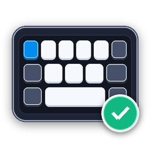

<p align="center">
  
  <h1 align="center">KeyboardChatteringFix</h1>
  <strong>Stops keys and mouse clicks from registering twice on Windows</strong><br>
  한 번 누른 키나 마우스 클릭이 두 번 입력되는 현상(채터링)을 막아주는 가벼운 Windows 유틸리티
</p>

<p align="center">
  
  
  
  
</p>

---

## Language / 언어 선택
- [English](#english)
- [한국어](#한국어)

---

<a id="english"></a>
## English

### What is this repository?

**KeyboardChatteringFix** is a lightweight Windows desktop app that prevents **switch chatter** — when a worn or noisy keyboard key or mouse button types/clicks twice (or more) from a single press.

Just launch it and leave it in the system tray: it blocks accidental bounces in real time while leaving normal fast typing, auto-repeat, IME input, and macros untouched.

> This repository hosts both the **source code** for KeyboardChatteringFix and a **Scoop bucket** (`bucket/`) so Windows users can install and update it directly via Scoop.

---

### Problems It Solves

- **Double-typed letters**: Pressing `E` or `Space` once produces `ee` or two spaces.
- **Accidental double-clicks**: A single mouse click opens files or closes tabs twice.
- **Stuttering holds & broken drags**: Holding a movement key in a game or dragging a window briefly drops and re-engages mid-hold.
- **Dirty keyboard accidents**: You want to wipe down keycaps without unplugging the keyboard or typing random commands.

---

### Key Features

#### 1. Smart Real-Time Filtering
- **Blocks bounces, keeps real typing**: Only ignores rapid unintended re-presses within your block window (default **35 ms** from key release). Normal fast typing, held-key auto-repeat, and software input (IMEs, AutoHotkey, remote desktop) pass through cleanly.
- **Optional mouse button filtering**: Stops single clicks on left, right, middle, or side mouse buttons from firing twice, using a separate default window (**30 ms**) so intentional double-clicks keep working.
- **Hold stabilization (`Release delay`)**: Optionally holds back a key or button release for a short window (e.g. 20–40 ms) so a brief mid-hold contact flicker doesn't drop a mouse drag or interrupt movement in games.
- **Physical-key awareness**: Main `Enter`/arrows and numpad `Enter`/arrows are tracked independently so switching between them never triggers false blocks.

#### 2. Per-Key Tuning & Automatic Suggestions (**Keys/Mouse** tab)
- **Custom limits per key**: Keep a low global threshold and give a single troublesome key (or mouse button) its own block window — or set it to `0 ms` to leave a specific key/button completely unfiltered.
- **Automatic threshold suggestions**: The app quietly remembers how fast you type vs. how fast a key bounces across sessions. Once enough presses are collected, it suggests a tailored threshold for each chattering key (with one-click **Apply suggestions**), or warns **"Check switch"** when bounces and real presses overlap and cleaning/replacement is needed.

#### 3. Live Diagnostics & History (**Home** & **History** tabs)
- **At-a-glance health**: See total presses, blocked bounces, block rate, the most recent blocked key, and which key fails most often.
- **Filterable log & CSV export**: View *Blocked only*, *All input*, or *Per-key summary*, search by key name, double-click a key row to jump straight to tuning it, or export the log to an Excel-ready CSV file (**File > Export history (CSV)…**).

#### 4. Keyboard Cleaning Mode
- Lock all key presses with one click (from the **Home** tab, tray menu, or a hotkey) so you can safely wipe your keyboard.
- Press `Enter` or click **Finish cleaning** when done — and if you forget, it unlocks automatically after **5 minutes**.

#### 5. Auto Pause & Quick Tray Controls
- **Auto pause for games & apps**: Automatically step aside while full-screen apps or specific executables (e.g. `game.exe; obs64.exe`) are in front.
- **Timed pause**: Pause protection for **15 minutes** or **1 hour** from the tray or **Tools** menu; protection resumes automatically when time is up.
- **Global hotkeys**: Toggle protection or start cleaning mode from anywhere (configured in the **Advanced** tab).
- **Tray-friendly**: Closing the window (`X`) keeps protection running in the system tray (the icon turns gray when paused or off).

#### 6. Native Windows Experience & Convenience
- **Auto theme & language**: Automatically matches Windows Dark/Light mode and switches between **English** and **Korean** based on your Windows language (or pin your preference in **Settings**).
- **Custom block sound**: Play the system beep or your own `.wav` sound whenever a bounce is blocked, with an in-app preview button.
- **Portable mode**: Place a `settings.ini` file next to the `.exe` to store settings locally instead of `%APPDATA%`.
- **Safe updates**: Use **Help > Check for Updates…** (or right-click the tray icon > **Check for Updates**) to verify and install signed updates safely.

---

### Installation & Quick Start

#### Option 1: Download ZIP (Recommended for most users)
1. Download `KeyboardChatteringFix.zip` from [Releases](https://github.com/twbeatles/keyboard-chattering-fix/releases).
2. Extract it anywhere and **keep both `.exe` files together** (`KeyboardChatteringFix.exe` and the `kcfix-updater.exe` update helper).
3. Run `KeyboardChatteringFix.exe`.

#### Option 2: Install via Scoop
```powershell
scoop bucket add kcfix https://github.com/twbeatles/keyboard-chattering-fix
scoop install kcfix/keyboard-chattering-fix
```
> Update anytime with `scoop update keyboard-chattering-fix`. *(A `winget` manifest is also prepared under `packaging/winget/`.)*

#### First-Time Setup in 3 Steps
1. **Run with defaults**: Protection starts immediately at **35 ms**. For most keyboards, this stops chatter right away without affecting typing.
2. **Check troublesome keys**: After typing normally for a while, open the **Keys/Mouse** tab to see keys with **Suggested** thresholds and apply them in one click.
3. **Fine-tune if needed**: If one key still double-types, raise just that key's window; if fast intentional double-taps get swallowed, lower the global window in **Settings**.

---

### Good to Know / FAQ

- **Elevated (Administrator) windows**: Standard Windows apps cannot filter input inside windows running as administrator (such as Task Manager or admin terminals). The **Home** tab alerts you when such a window is active; use **Tools > Run as administrator** if you need protection there too. *(For **Start as administrator at sign-in**, place the app inside `Program Files` for security.)*
- **Games & anti-cheat**: Because the filter uses a system-wide input hook, add sensitive games to **Excluded apps** or enable **Pause while a full-screen app is in front** in **Settings**.
- **Mouse drags or held keys dropping**: Turn on **Release delay** (20–40 ms) in the **Advanced** tab to ignore momentary contact flickers while holding a key or mouse button.
- **Hardware / QMK / VIA keyboards**: If your keyboard supports custom firmware debounce, raising firmware `DEBOUNCE` fixes chatter at the hardware source. Software filtering is ideal when firmware tuning isn't available.

---

<details>
<summary><strong>Advanced: Configuration File (<code>settings.ini</code>), CLI, Updates & Building from Source</strong></summary>

#### Configuration File (`settings.ini`)
Settings live in `%APPDATA%\KeyboardChatteringFix\settings.ini` (or next to the executable in portable mode):

```ini
[KeyboardChatteringFix]
iThreshold=35          # Global chatter threshold in ms (1–1000)
bFilterEnabled=1       # Enable (1) or disable (0) chatter filtering
bPlaySound=0           # Play notification sound on block (1=On, 0=Off)
lpSoundFile=           # Path to custom .wav file (empty = default beep)
bMinimizeOnLaunch=0    # Minimize to tray on startup (1=On, 0=Off)
bCloseToTray=1         # Minimize to tray on window close (1=On, 0=Exit)
bRecordAllKeypress=0   # Telemetry log: 1=record all keys, 0=blocked chatter only
iLogLimit=100          # Maximum in-memory log buffer size
sLanguage=auto         # Interface language: "auto" (follows Windows), "ko", or "en"
sMeasureFrom=release   # Measurement baseline: "release" or "press"
iMinChatterMs=0        # Ignore chatter intervals below this limit (ms)
bExcludeInjected=1     # Ignore synthetic events from AHK/IME/macros (1=On)
bFilterMouse=0         # Also filter mouse button chatter (1=On)
iMouseThreshold=30     # Block window of mouse buttons without their own key.XX (ms, 1–1000)
iReleaseDeferMs=0      # Hold releases of held keys back this long (0=off, 0–100; 20–40 typical)
sAutoDisableApps=      # Pause while these apps are in front, e.g. "game.exe; obs64.exe"
bAutoDisableFullscreen=0 # Pause while any full-screen app is in front (1=On)
sHotkeyToggle=         # Hotkey that toggles protection, e.g. "Ctrl+Alt+F12" (empty = none)
sHotkeyCleaning=       # Hotkey that starts cleaning mode, e.g. "Ctrl+Alt+F11"
iCleaningTimeoutMin=5  # Cleaning mode ends by itself after N minutes (0 = never)

# Per-key overrides: key.<HEX_VIRTUAL_KEY>=<MILLISECONDS>
key.48=120             # Custom 120ms threshold for 'H' key (0x48)
key.20=80              # Custom 80ms threshold for Spacebar (0x20)
key.01=30              # Custom 30ms threshold for the left mouse button
key.02=0               # 0 = never filter this key or button (right mouse button)
```

> Statistics (`stat.XX`) and measured gap histograms (`sHistMeasure`, `hist.XX`) are managed automatically at the bottom of the file.

#### Command Line Options

| Option | Effect |
|---|---|
| `--version` / `-V` | Print the version |
| `--check-update` | Check for a newer release |
| `--check-helper` | Verify `kcfix-updater.exe` is usable (exit code 0) |
| `--check-language` | Show which language `auto` selects on this PC |

#### Checking for Updates & Release Pipeline
- Use **Help > Check for Updates…**, right-click the tray icon > **Check for Updates**, or run `KeyboardChatteringFix.exe --check-update`.
- Update manifests are cryptographically signed (Ed25519) and applied by `kcfix-updater.exe` with automatic rollback on failure. See [docs/UPDATE.md](docs/UPDATE.md) for maintainer details.
- Behind a proxy: `HTTPS_PROXY`/`ALL_PROXY` and manual Windows proxy settings are supported.

#### Building & Testing (Rust 2024 / MSRV 1.85 on Windows 10/11 64-bit)
```powershell
git clone https://github.com/twbeatles/keyboard-chattering-fix.git
cd keyboard-chattering-fix

cargo test --workspace
cargo build --release
```
The compiled binary is created at `target/release/keyboard-chattering-fix.exe`.

#### Repository Layout
- `src/` — Main Windows application (`app/`, `input/`, `debounce/`, `recommend/`, `config/`, `i18n/`, `ui/`, `updater/`)
- `crates/kcfix-updater/` — Companion updater helper for safe in-place executable replacement
- `bucket/` — Scoop manifest (`kcfix` bucket)
- `packaging/` — App icons and `winget` manifests
- `scripts/` & `tests/` — Release/signing scripts, E2E checks, and automated tests

</details>

---

<a id="한국어"></a>
## 한국어

### 이 프로젝트는 무엇인가요?

**KeyboardChatteringFix**는 오래 쓰거나 접점이 불안정한 키보드·마우스에서 **한 번만 눌렀는데 두 번 이상 입력되는 현상(채터링 / 더블클릭)**을 실시간으로 막아주는 가벼운 Windows 프로그램입니다.

프로그램을 켜 두기만 하면 창을 닫더라도 작업 표시줄 트레이에서 조용히 동작하며, 평범한 타이핑이나 빠른 연타, 한영 입력(IME), 매크로는 방해하지 않고 문제가 되는 중복 입력만 골라서 걸러 줍니다.

> 이 리포지토리는 프로그램의 **소스 코드**를 담고 있으며, 동시에 Windows 패키지 관리자인 **Scoop 버킷**(`bucket/`) 역할도 함께 수행합니다.

---

### 이런 문제를 해결해 줍니다

- **글자 중복 입력**: `ㄱ`이나 `Space`를 한 번 눌렀는데 `ㄱㄱ` 또는 공백이 두 번 찍히는 경우
- **마우스 헛클릭(더블클릭 현상)**: 클릭을 한 번만 했는데 창이 닫히거나 파일이 두 번 열리는 경우
- **게임 이동·드래그 끊김**: 키나 마우스 버튼을 꾹 누르고 있는 동안 접점이 잠깐 튀어 이동이 멈추거나 드래그가 풀리는 경우
- **키보드 청소 중 오입력**: USB를 뽑지 않고 키캡을 닦다가 엉뚱한 키가 눌리는 경우

---

### 주요 기능

#### 1. 똑똑한 실시간 채터링 차단
- **튀는 입력만 정밀 차단**: 키를 뗀 직후 아주 짧은 시간(기본 **35 ms**) 안에 다시 들어오는 오입력만 막아 줍니다. 평소 타자, 키를 꾹 누르는 연속 입력(오토리핏), 한글 쌍자음 입력(`ㅆ`, `뺐`, `있습니다` 등), 원격 데스크톱 및 매크로 프로그램 입력은 자연스럽게 통과합니다.
- **마우스 버튼 채터링 방지 (선택)**: 왼쪽·오른쪽·가운데·측면 버튼의 원치 않는 더블클릭도 막아 줍니다. 의도적인 빠른 더블클릭이 씹히지 않도록 마우스에는 별도 기준(기본 **30 ms**)을 적용합니다.
- **눌림 유지 보정 (`떼기 확인 시간`)**: 키나 버튼을 누르고 있는 도중 접점이 미세하게 떨어졌다 붙는 현상을 보완해(예: 20~40 ms 설정), 게임 중 이동 끊김이나 마우스 드래그 풀림을 줄여 줍니다.
- **물리 키 구분**: 일반 `Enter`·방향키와 숫자패드 `Enter`·방향키를 서로 다른 키로 구분해 오작동을 막습니다.

#### 2. 키별 맞춤 설정 & 자동 기준 추천 (**키·마우스** 탭)
- **키·버튼별 개별 기준**: 전체 키에는 낮은 기준을 두고, 유독 말썽인 키나 마우스 버튼에만 더 높은 기준을 줄 수 있습니다. 기준을 `0 ms`로 지정하면 해당 키·버튼은 필터를 적용하지 않습니다.
- **사용 패턴 기반 권장값 제안**: 평소 입력 간격과 채터링 간격을 프로그램이 꾸준히 기록해 두었다가, 키마다 적절한 차단 기준을 계산해 추천해 줍니다(**권장값 모두 적용**으로 한 번에 반영 가능). 만약 정상 입력과 튄 입력이 겹쳐 소프트웨어로 구분하기 어렵다면 **"스위치 점검"** 안내로 청소나 교체가 필요한 시점을 알려 줍니다.

#### 3. 한눈에 보는 통계와 기록 (**홈** / **기록** 탭)
- **실시간 입력 통계**: 전체 입력 수, 막은 횟수, 차단 비율(%), 가장 최근에 막은 키, 가장 자주 튀는 키를 실시간으로 확인할 수 있습니다.
- **상세 입력 기록 & 엑셀 내보내기**: *막은 입력만 / 모든 입력 / 키별 통계* 보기를 전환하고 키 이름으로 검색할 수 있습니다. 통계 행을 두 번 클릭하면 해당 키 설정으로 바로 이동하며, **파일 > 기록 내보내기(CSV)…**로 엑셀에서 바로 열리는 기록 파일을 저장할 수 있습니다.

#### 4. 키보드 청소 모드
- **홈** 탭 버튼, 트레이 아이콘 우클릭 메뉴, 또는 단축키로 **키보드 청소 모드**를 켜면 모든 키 입력을 일시 잠가 안심하고 키보드를 닦을 수 있습니다.
- 청소가 끝나면 `Enter` 키를 누르거나 **청소 끝내기** 버튼을 클릭하세요. 깜빡하고 끄지 않아도 **5분**이 지나면 자동으로 해제됩니다.

#### 5. 상황별 자동 일시 중지 & 빠른 제어
- **게임·전체 화면 자동 일시 중지**: 특정 프로그램(예: `game.exe; obs64.exe`)이나 전체 화면 앱이 앞에 있을 때는 보호를 자동으로 잠시 멈춥니다.
- **시간 정해 잠시 멈추기**: 트레이 메뉴 또는 **도구** 메뉴에서 **15분** 또는 **1시간** 동안 잠시 멈출 수 있으며, 시간이 지나면 자동으로 보호가 재개됩니다.
- **전역 단축키**: 어떤 화면에서든 보호 켜기/끄기 및 청소 모드를 바로 실행할 수 있습니다(**고급** 탭에서 지정).
- **깔끔한 트레이 상주**: 창을 닫아도(`X`) 트레이에서 계속 보호하며, 보호가 꺼지거나 멈추면 트레이 아이콘이 회색으로 바뀝니다.

#### 6. Windows에 맞춘 편의 기능
- **다크/라이트 모드 & 언어 자동 맞춤**: Windows 테마와 언어 설정(한국어 / English)을 자동으로 따라가며, **설정** 탭에서 원하는 언어로 고정할 수도 있습니다.
- **알림음 & 커스텀 `.wav` 지원**: 입력을 막았을 때 기본 알림음이나 원하는 `.wav` 파일을 재생할 수 있고, 설정 화면에서 바로 미리 들어볼 수 있습니다.
- **포터블 모드**: 실행 파일 옆에 `settings.ini` 파일을 두면 `%APPDATA%` 대신 해당 파일에 설정을 저장합니다.
- **안전한 업데이트 확인**: **도움말 > 업데이트 확인** 또는 트레이 아이콘 우클릭 → **업데이트 확인**으로 새 버전을 확인하고 안전하게 업데이트할 수 있습니다.

---

### 설치 및 빠른 시작

#### 방법 1: ZIP 내려받기 (일반 사용자 추천)
1. [Releases](https://github.com/twbeatles/keyboard-chattering-fix/releases)에서 `KeyboardChatteringFix.zip`을 내려받습니다.
2. 원하는 폴더에 압축을 풀고 **두 실행 파일(`KeyboardChatteringFix.exe`, `kcfix-updater.exe`)을 같은 폴더에 함께 둡니다**.
3. `KeyboardChatteringFix.exe`를 실행하면 바로 보호가 시작됩니다.

#### 방법 2: Scoop으로 설치
```powershell
scoop bucket add kcfix https://github.com/twbeatles/keyboard-chattering-fix
scoop install kcfix/keyboard-chattering-fix
```
> 업데이트는 `scoop update keyboard-chattering-fix` 명령으로 진행합니다. *(참고: `packaging/winget/`에 winget 매니페스트도 준비되어 있습니다.)*

#### 3단계로 시작하기
1. **기본 설정으로 바로 쓰기**: 처음 실행하면 **35 ms** 기준으로 즉시 동작합니다. 대부분의 경우 별도 조정 없이도 이중 입력이 사라집니다.
2. **문제 키 확인하기**: 한동안 평소처럼 타자를 친 뒤 **키·마우스** 탭을 열면, 채터링이 감지된 키의 **권장** 값을 확인하고 한 번에 적용할 수 있습니다.
3. **세부 조정하기**: 특정 키만 계속 두 번 찍히면 그 키의 기준만 높이고, 빠른 의도적 연타가 막힌다면 **설정** 탭에서 전체 기준을 조금 낮춰 보세요.

---

### 알아두면 좋은 점 / 자주 묻는 질문

- **관리자 권한으로 실행된 창**: 일반 권한으로 실행 중일 때는 보안상 작업 관리자나 관리자 터미널처럼 관리자 권한으로 열린 창의 입력을 걸러낼 수 없습니다. 그런 창이 앞에 있으면 **홈** 탭에서 안내해 주며, 필요 시 **도구 > 관리자 권한으로 다시 실행**을 사용하면 됩니다. *(로그인 시 관리자 권한 자동 실행을 안전하게 쓰려면 프로그램을 `Program Files` 폴더에 두고 사용하세요.)*
- **온라인 게임 및 안티치트**: 입력을 가로채는 동작 특성상 일부 게임의 안티치트와 충돌할 수 있습니다. **설정** 탭의 **제외할 프로그램** 목록에 게임을 추가하거나 **전체 화면 앱이 앞에 있으면 잠시 멈추기**를 켜 두면 편리합니다.
- **마우스 드래그·게임 이동 키가 끊길 때**: 키를 누르고 있는 도중 잠깐 떨어지는 현상 때문일 수 있습니다. **고급** 탭의 **떼기 확인 시간**을 `20~40 ms`로 설정해 보세요.
- **QMK/VIA 지원 키보드**: 펌웨어에서 직접 디바운스(`DEBOUNCE`) 값을 올릴 수 있는 키보드라면 펌웨어 조정이 가장 근본적인 해결책입니다. 소프트웨어 필터는 하드웨어 교체가 어렵거나 즉시 증상을 막고 싶을 때 유용합니다.

---

<details>
<summary><strong>고급 안내: 설정 파일(<code>settings.ini</code>), 명령줄 옵션, 업데이트 및 직접 빌드</strong></summary>

#### 설정 파일 (`settings.ini`)
설정은 `%APPDATA%\KeyboardChatteringFix\settings.ini`(포터블 모드에서는 실행 파일 옆 `settings.ini`)에 저장됩니다:

```ini
[KeyboardChatteringFix]
iThreshold=35          # 전역 채터링 임계값(ms). 이 시간 내의 재입력은 차단됨
bFilterEnabled=1       # 채터링 필터 활성화 (1=켜짐, 0=꺼짐)
bPlaySound=0           # 차단 시 알림음 재생 여부 (1=켜짐, 0=꺼짐)
lpSoundFile=           # 사용자 지정 .wav 사운드 파일 경로 (비우면 기본 비프음)
bMinimizeOnLaunch=0    # 실행 시 트레이로 최소화 (1=켜짐, 0=꺼짐)
bCloseToTray=1         # 창 닫기(X) 시 트레이로 최소화 (1=켜짐, 0=완전 종료)
bRecordAllKeypress=0   # 모든 키 누름 로깅 (1=모든 키, 0=차단된 채터링만)
iLogLimit=100          # 메모리 내 실시간 로그 보관 수
sLanguage=auto         # 인터페이스 언어 ("auto"=Windows 언어 자동 인식, "ko", "en")
sMeasureFrom=release   # 간격 측정 기준 ("release" 또는 "press")
iMinChatterMs=0        # 이 값보다 작은 간격은 결함 입력으로 간주하여 통과
bExcludeInjected=1     # 외부 매크로/IME 합성 입력 제외 (1=권장)
bFilterMouse=0         # 마우스 버튼 채터링도 막기 (1=켜짐)
iMouseThreshold=30     # 개별 key.XX가 없는 마우스 버튼의 차단 기준(ms, 1~1000)
iReleaseDeferMs=0      # 누르고 있는 키의 뗌을 이만큼 보류 (0=끔, 0~100, 보통 20~40)
sAutoDisableApps=      # 이 프로그램이 앞에 있으면 잠시 멈춤 (예: "game.exe; obs64.exe")
bAutoDisableFullscreen=0 # 전체 화면 앱이 앞에 있으면 잠시 멈춤 (1=켜짐)
sHotkeyToggle=         # 보호 켜기/끄기 단축키 (예: "Ctrl+Alt+F12", 비우면 없음)
sHotkeyCleaning=       # 청소 모드 단축키 (예: "Ctrl+Alt+F11")
iCleaningTimeoutMin=5  # 청소 모드 자동 종료(분, 0=끄지 않음)

# 키별 개별 임계값 설정: key.<16진수_가상키코드>=<밀리초>
key.48=120             # 'H' 키(0x48)에만 120ms 적용
key.20=80              # 스페이스바(0x20)에만 80ms 적용
key.01=30              # 마우스 왼쪽 버튼에만 30ms 적용
key.02=0               # 0 = 이 키·버튼은 거르지 않음 (마우스 오른쪽 버튼)
```

> 파일 하단의 누적 통계(`stat.XX`)와 권장 기준 계산용 간격 데이터(`sHistMeasure`, `hist.XX`)는 프로그램이 자동으로 관리합니다.

#### 명령줄 옵션

| 옵션 | 동작 |
|---|---|
| `--version` / `-V` | 버전 출력 |
| `--check-update` | 새 릴리스 확인 |
| `--check-helper` | 프로그램 옆 `kcfix-updater.exe` 사용 가능 여부 확인 (정상이면 종료 코드 0) |
| `--check-language` | 현재 PC에서 `auto`가 선택하는 언어 확인 |

#### 업데이트 확인 및 배포 구조
- 창 메뉴의 **도움말 > 업데이트 확인**, 트레이 아이콘 우클릭 → **업데이트 확인**, 또는 터미널에서 `KeyboardChatteringFix.exe --check-update`로 확인할 수 있습니다.
- 업데이트는 디지털 서명(Ed25519)과 해시 검증을 거친 뒤 `kcfix-updater.exe`가 안전하게 교체하며, 실패 시 자동으로 이전 버전으로 복구됩니다. 자세한 배포 절차는 [docs/UPDATE.md](docs/UPDATE.md)를 참고하세요.
- 프록시 환경에서는 `HTTPS_PROXY`/`ALL_PROXY` 또는 Windows 수동 프록시 설정을 지원합니다.

#### 직접 빌드 및 테스트 (Windows 10/11 64비트, Rust 2024 / MSRV 1.85)
```powershell
git clone https://github.com/twbeatles/keyboard-chattering-fix.git
cd keyboard-chattering-fix

cargo test --workspace
cargo build --release
```
빌드된 실행 파일은 `target/release/keyboard-chattering-fix.exe`에 생성됩니다.

#### 리포지토리 구성
- `src/` — 메인 프로그램 소스 (`app/`, `input/`, `debounce/`, `recommend/`, `config/`, `i18n/`, `ui/`, `updater/`)
- `crates/kcfix-updater/` — 안전한 파일 교체 및 롤백을 담당하는 업데이트 헬퍼
- `bucket/` — Scoop 패키지 설치용 버킷 매니페스트
- `packaging/` — 앱 아이콘 및 `winget` 매니페스트
- `scripts/` · `tests/` — 릴리스·서명 스크립트, E2E 검증, 자동화 테스트

</details>

---

### 라이선스 (License)

이 프로젝트는 [MIT License](LICENSE)에 따라 배포됩니다.
